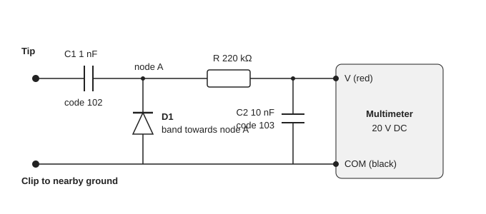
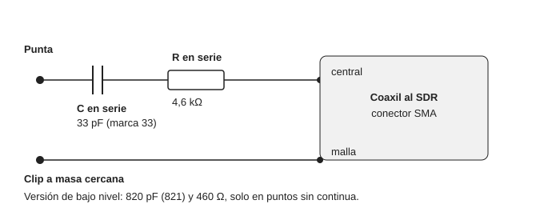

# Methodology and probes

How measurements were taken during the incident, so they can be repeated or compared.

## Probes

### Diode probe for a multimeter (peak voltage, DC blocked)

| Component | Value |
|---|---|
| C1 | 1 nF (102), ceramic, 50 V or more |
| D1 | 1N4148 (silicon) or 1N60 (germanium); band (cathode) towards node A |
| R | 220 kohm |
| C2 | 10 nF (103) |

- Use: tip on the point to measure, ground clip close by, multimeter on DC in the V jack (never in Amp), 20 V or 2 V range.
- Limitation: silicon does not rectify below about 0.5 V peak and germanium below about 0.2 V. A reading of 0 does not prove there is no signal.
- With the 1N60, do not exceed about 15 to 20 V peak (lower reverse voltage than silicon).

### Contact probe for the SDR (capacitive divider)

| Version | C | R | Approx. attenuation | Use |
|---|---|---|---|---|
| Main | 33 pF | 4.6 kohm | about 40 dB | Collectors, PO, T1 and T2 |
| Low level | 820 pF | 460 ohm | about 20 dB | Only points with no DC (DRV, Q1 base) |

The attenuation assumes a 50 ohm SDR input. It has no diode: the SDR needs the RF as is. The capacitor blocks DC and must be on the tip side.

## SDR settings (SDR++)

- **Same gain, same zoom, bandwidth and FFT size** across a whole series. Gain 25.4 was used (roughly half).
- CW, carrier at 50 %, dummy load, key held down 3 or 4 seconds per point.
- Record the SNR of the line that **only appears on TX**. In CW that line can sit a few hundred Hz away from the RX frequency.
- SNR is not linear: take differences as a guide (plus or minus 5 to 10 dB). If a point saturates, record it as "saturated".

## SDR frequency by point

| Group | Frequency |
|---|---|
| IF unit, J30, J32 and J35 (TIF) | 8.83 MHz (TX carrier around 8825 to 8831 kHz) |
| C52, BPF, Q7 to Q9, DRV, Final unit and PO | Operating frequency (for example 7074 kHz) |

Comparing levels between the two groups with the same probe and gain is valid to within a few dB of frequency-dependent difference.

## TX path with test points

| # | Unit | Point | Frequency |
|---|---|---|---|
| 1 | IF unit | J30, GEN pin | 8.83 MHz |
| 2 | IF unit | J32, TIF pin | 8.83 MHz |
| 3 | RF unit | J35, pin 2 (TIF) | 8.83 MHz |
| 4 | RF unit | C52, pad on the R36 side (under Q6) | Operating |
| 5 | RF unit | C11 (leg on the L8 side and on the L7 side) and C10 (leg on the L6 side): 7 MHz section, the row with C12 100P, C11 39P and C10 82P | Operating |
| 6 | RF unit | C54, leg on the Q7 side (BPF output) | Operating |
| 7 | RF unit | J34, ANT and MKR pins (leakage towards the antenna) | Operating |
| 8 | RF unit | DRV (output) | Operating |
| 9 | Final | DRV (input), Q1 collector (C6 leg), Q2/Q3 collectors (C15 legs), Q4/Q5 bases | Operating |
| 10 | Final | PO (only with the carrier at minimum) | Operating |

Criterion: the level should rise or hold between consecutive points according to the nominal gains (see [measurements](03-measurements-and-levels.md)). A drop of 20 dB or more between two points marks the broken section.

## Precautions

- Red multimeter lead **always in the V jack** for voltage. In the Amp jack it is a dead short.
- Do not put the probe on the T4 primary or on the Q4/Q5 collectors (strong RF and 13.8 V very close to ground).
- Do not probe the pins of the 3SK74s with test leads (four pins close together); measure on neighboring components or by voltage.
- On the power bipolars static is not critical; on the RF unit 3SK74s it is: touch ground frequently.
- With the radio off and the DC cable unplugged for ohmmeter work and for touching boards. On TX, measurements of 3 to 5 seconds.
- Do not touch VR1 or VR2 until a fault is resolved.
