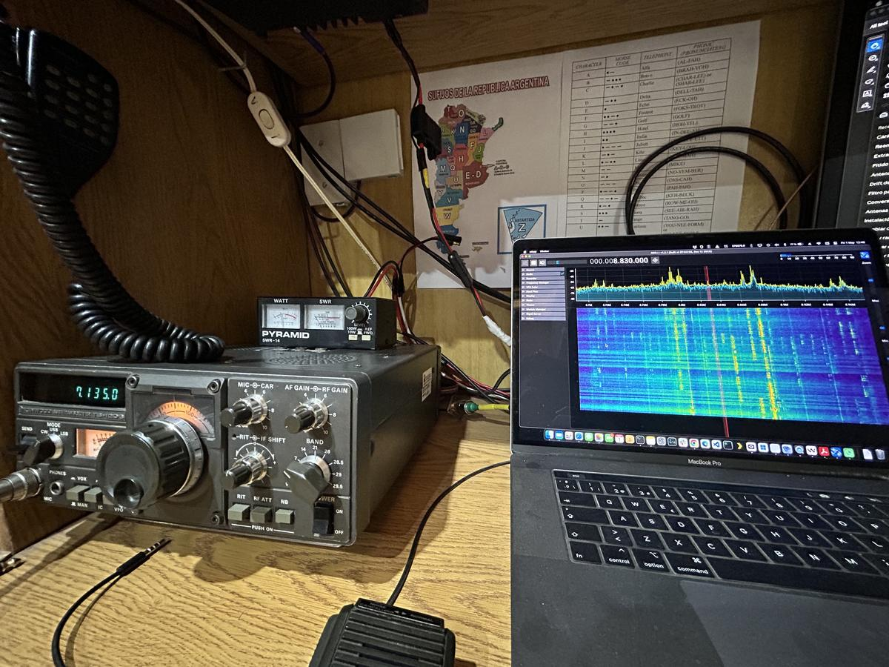
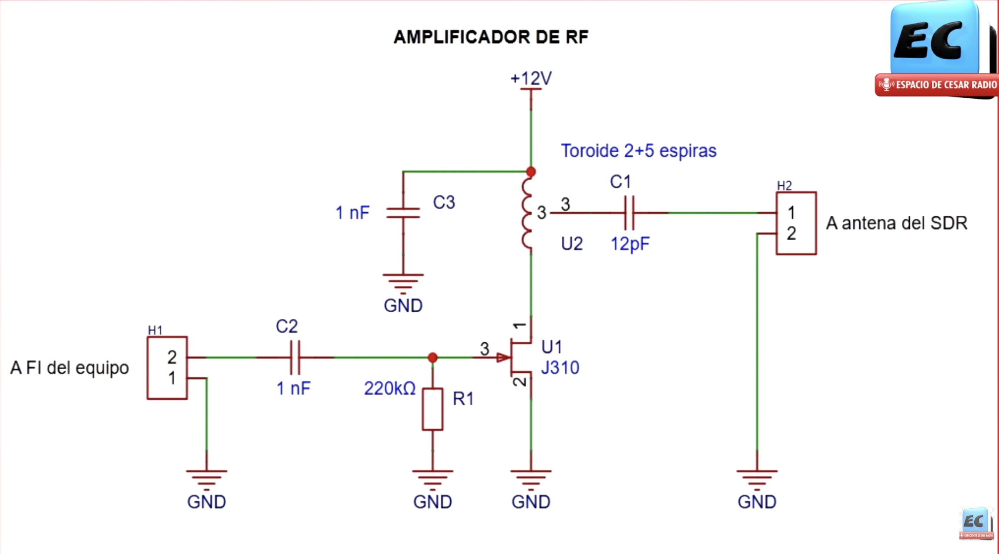
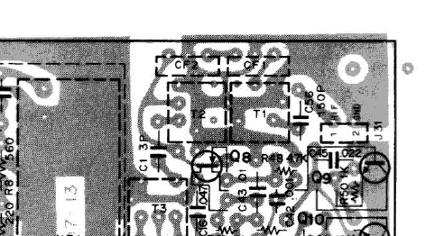
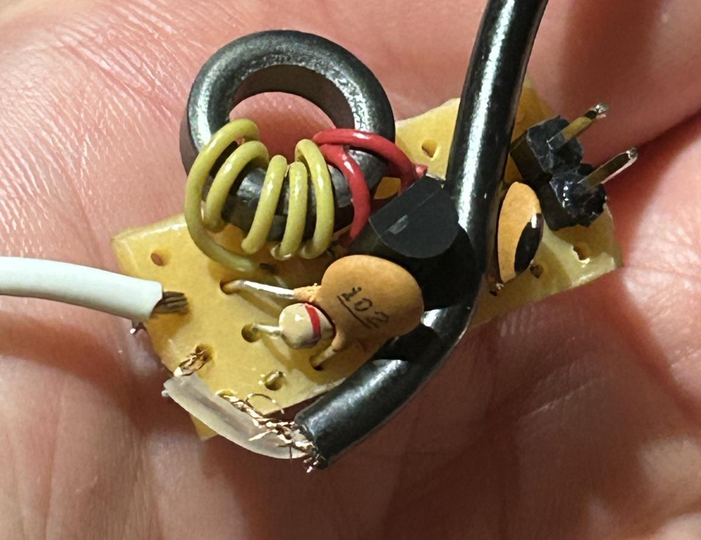

# IF output for an SDR panadapter (improvement)

This is an **improvement**, not a repair. An RTL-SDR Blog V4 is fed from the TS-120S's 8.83 MHz IF and used as a **panadapter**: spectrum and waterfall around the operating frequency. There is **no CAT** link, because the TS-120S has no computer interface. The SDR stays on the fixed IF (8.83 MHz), and whatever the VFO is tuned to appears at the center of the display.

The build follows a video from the YouTube channel *Espacio de César*: [source video](https://www.youtube.com/watch?v=JrP153SrSbA&t=358s) ([schematic shown at 1:30](https://www.youtube.com/watch?v=JrP153SrSbA&t=90s)).

Video of this radio working with the IF panadapter: [TS-120S + IF panadapter](https://www.youtube.com/watch?v=3ZGHC09Vlz8).



*TS-120S on 7135.0 kHz. The SDR on the laptop is centered on 8.830 MHz (the IF) and shows the 40 m band around the operating frequency.*

## Overview

```
IF unit, CF1 (8.83 MHz) ──► J310 buffer amplifier (9 V) ──► coax ──► RTL-SDR Blog V4 ──► SDR software (PC)
```

- **Buffer amplifier** between the IF line and the SDR input. It does two jobs:
  - **Impedance matching** between the high-impedance IF tap and the 50 ohm SDR input.
  - **Isolation**, so the SDR does not load the IF line too much and desensitize the TS-120S receiver.
- **SDR software:** currently a fork of [bubnikv/sdriak](https://github.com/bubnikv/sdriak).

## Schematic



*Schematic: Espacio de César Radio ([video, 1:30](https://www.youtube.com/watch?v=JrP153SrSbA&t=90s)).*

| Ref | Part | Function |
|---|---|---|
| C2 | 1 nF | Input DC block from the IF tap. In this build it is soldered directly at the tap on the IF unit (CF1), not on the board |
| R1 | 220 kohm | Gate to ground (high input impedance, light load on the IF) |
| U1 | **J310** (N-channel JFET, TO-92) | Common-source amplifier, source to ground |
| U2 | Ferrite toroid, **5 + 2 turns** | 5-turn drain winding to +V; 2-turn output winding steps the impedance down for the SDR |
| C1 | 12 pF | Output coupling to the SDR |
| C3 | 1 nF | Supply bypass at the cold end of the drain winding |

Differences in this build compared with the original schematic:

- Powered from **9 V** instead of 12 V.
- **C2 (1 nF)** is not on the board: it is soldered directly at the tap on the IF unit (CF1), so it does not show in the board photo.

## Tap point in the radio

The buffer input (H1) connects to the **IF unit, CF1, top-right pin** (as seen in the PCB layout below), through C2 (1 nF), which is soldered right at that pin.



## The board



It is built on a small piece of perfboard:

- The toroid with its two windings: yellow (5 turns) and red (2 turns).
- The J310 in TO-92.
- Ceramic capacitors, including the 1 nF (102) discs.
- A 2-pin header for power.
- A white wire on the IF side and a thin black coax to the SDR.

## Results

| Condition (40 m) | Drop on the TS-120S S-meter when the SDR is connected |
|---|---|
| SDR tapped directly on the IF, **no buffer** | about **2 S-units** |
| **With the buffer** | **less than 1 S-unit** |

The buffer does its job: the receiver is far less loaded with it than with a direct connection.

## Usage notes

- The SDR is tuned to the fixed IF, **8.83 MHz**, and left there. The frequency scale in the SDR software shows IF frequencies, not dial frequencies. Read the operating frequency on the radio.
- For relative measurements, the SDR gain was set to **0 dB** as a reference. SDR levels are relative SNR, not calibrated (see [03](03-measurements-and-levels.md) and [05](05-methodology-and-probes.md)).
- The panadapter also showed simultaneous gain variations across all signals in the waterfall (see [06](06-open-items.md)).

## On TX

The SDR picks up a fairly strong signal on TX, but it **does not saturate**. That makes it useful as a modulation monitor: the level, shape and width of the transmitted signal can be watched on the waterfall. It is not known yet whether the TX signal arrives **directly through the IF tap** (probably not) or by **proximity pickup** from the transmitter inside the radio.

## Possible next steps

- Find out how the TX signal reaches the SDR. Lift the buffer input from CF1, keep the buffer powered and the coax connected, and transmit into a dummy load. If the signal is still there, it is proximity pickup inside the radio. If it disappears, it comes through the IF line.
- Measure the remaining S-meter drop again now that IF T6 has been peaked (2026-11-01), with the SDR connected and disconnected.
