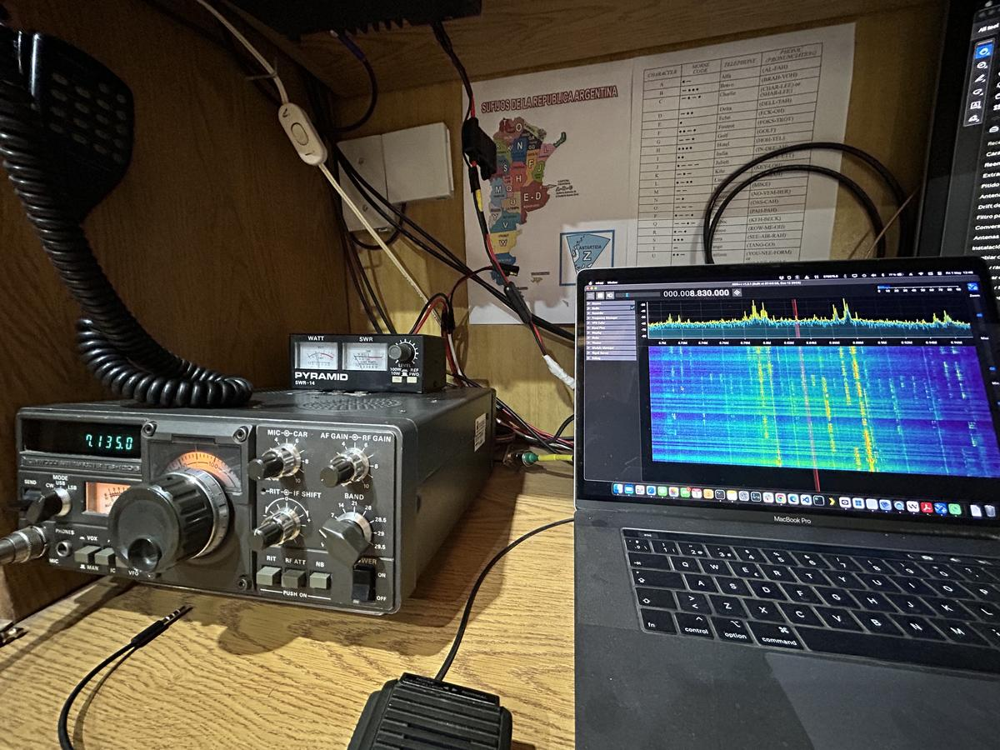
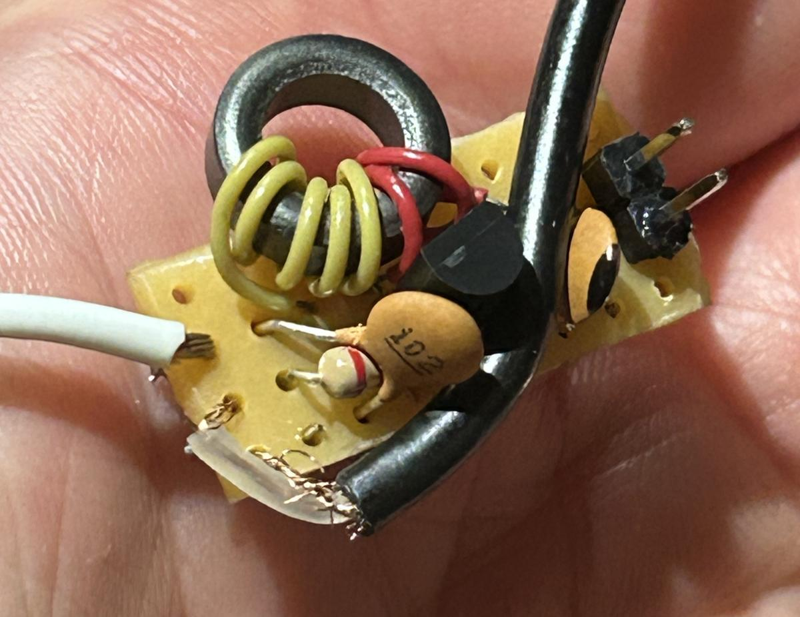

# IF output for an SDR panadapter (improvement)

An **improvement**, not a repair: an RTL-SDR Blog V4 is fed from the TS-120S's 8.83 MHz IF and used as a **panadapter** (spectrum and waterfall around the operating frequency). There is **no CAT** link: the TS-120S has no computer interface, so the SDR does not follow the VFO and is tuned by hand to the IF.

The build follows a video from the YouTube channel *Espacio de César*: [source video](https://www.youtube.com/watch?v=JrP153SrSbA&t=358s).

Video of this radio working with the IF panadapter: [TS-120S + IF panadapter](https://www.youtube.com/watch?v=3ZGHC09Vlz8).



*TS-120S on 7135.0 kHz; SDR++ on the laptop centered on 8.830 MHz, showing the 40 m band through the IF.*

## Overview

```
TS-120S IF line (8.83 MHz) ──► buffer amplifier (9 V) ──► coax ──► RTL-SDR Blog V4 ──► SDR++ (PC)
```

- **Buffer amplifier** between the IF line and the SDR input. It does two jobs:
  - **Impedance matching** between the high-impedance IF tap and the 50 ohm SDR input.
  - **Isolation**, so the SDR does not load the IF line too much and desensitize the TS-120S receiver.
- Powered from **9 V**.
- A **200 ohm resistor** in the buffer limits the level sent to the SDR.

## The board



What can be seen in the photo (small piece of perfboard):

- A ferrite **toroid transformer** with two windings (yellow and red wire).
- One **TO-92 transistor** (the buffer stage).
- Ceramic capacitors, including a **102 (1 nF)** disc.
- A **2-pin header** (power).
- A **white wire** (IF side) and a **black thin coax** (to the SDR).

The exact schematic, the transistor type, the IF tap point inside the radio and the turns count are **not recorded yet**. Add them here when confirmed.

## Results

| Condition (40 m) | Drop on the TS-120S S-meter when the SDR is connected |
|---|---|
| SDR tapped directly on the IF, **no buffer** | about **2 S-units** |
| **With the buffer** | **less than 1 S-unit** |

The buffer does its job: the receiver is far less loaded with it than with a direct connection.

## Usage notes

- SDR center frequency: **8.83 MHz**. The radio IF is a single conversion, so the spectrum is shown relative to the IF, not on the real band frequency. Because there is no CAT, the frequency labels in SDR++ do not match the dial. A fixed offset (or frequency inversion, depending on sideband and injection) has to be worked out by hand.
- For relative measurements the SDR gain was set to **0 dB** as a reference. SDR levels are relative SNR, not calibrated (see [03](03-measurements-and-levels.md) and [05](05-methodology-and-probes.md)).
- The panadapter also showed simultaneous gain variations across all signals in the waterfall, possibly from the switching power supply (see [06](06-open-items.md)).

## On TX

The SDR picks up a fairly strong signal on TX, but it **does not saturate**. That makes it useful as a modulation monitor: level, shape and width of the transmitted signal can be watched on the waterfall. It is not known yet whether the TX signal arrives **directly through the IF tap** (probably not) or by **proximity pickup** from the transmitter inside the radio.

## Possible next steps

- Draw the schematic of the board and record the IF tap point.
- Measure the remaining S-meter drop again now that IF T6 has been peaked (2026-11-01).
- Work out the SDR++ frequency offset/inversion so the waterfall reads in real dial frequency.
- Find out how the TX signal reaches the SDR: lift the buffer input from the IF tap (buffer still powered, coax still connected) and transmit into a dummy load. If the signal is still there, it is proximity pickup inside the radio; if it disappears, it comes through the IF line.
